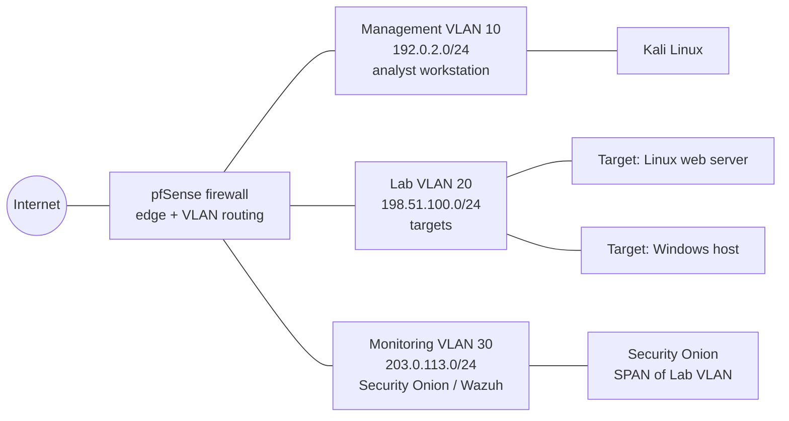

# Lab network (planned)

Addresses use the documentation ranges (RFC 5737), so nothing here is a real network.

## Segments

| VLAN | Range | Purpose | Reaches |
|---|---|---|---|
| 10 Management | 192.0.2.0/24 | Analyst workstation, Kali | Lab and Monitoring (controlled) |
| 20 Lab | 198.51.100.0/24 | Deliberately vulnerable targets | Internet blocked; Monitoring mirrored |
| 30 Monitoring | 203.0.113.0/24 | IDS/SIEM, log collection | Receives traffic; initiates nothing |

Rules follow the "every rule has a business purpose" principle: each permitted flow is listed in `infra/` with its reason.
